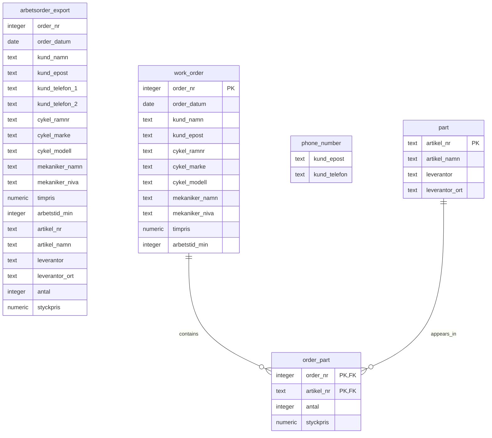

# Cykelverkstaden Trampen — Database Normalization

## Project overview

This project uses sample work-order data from the fictional bicycle workshop Cykelverkstaden Trampen to explore relational database design and normalization.

The starting point is a spreadsheet-style export, `arbetsorder_export`, containing work-order, customer, bicycle, mechanic, and spare-part information.

The project documents the transformation of this source data through **First Normal Form (1NF)** and **Second Normal Form (2NF)**. Further analysis of functional dependencies and decomposition into 3NF will follow.

## Current ER schema — 2NF

The diagram shows the original source relation and the relations created during the 1NF and 2NF steps. The normalized relations shown are the current 2NF design.

The `work_order` relation is shown in its **2NF form**: one row per work order, with the spare-part line attributes moved to `order_part`. The source table and the initial 1NF version of `work_order` are retained in the diagram to show the progression.

The `phone_number` relation stores customer phone numbers as separate rows. Its identifying rule is based on the customer-email/phone pair; the design does not assume that email alone is a unique customer identifier.

## Project timeline

### 1. Create the raw dataset — `01_raw_table.sql`

The first script creates and populates `arbetsorder_export` with nine sample rows representing five work orders.

The table is retained as the original, unnormalized source for analysis and comparison. It contains customer phone numbers in two separate columns (`kund_telefon_1` and `kund_telefon_2`), alongside work-order and spare-part data.

The script also includes an initial row-count check.

### 2. Decompose the data for 1NF — `02_Cykelverkstaden_1NF.sql`

The 1NF step addresses the repeating phone-number columns identified in the original table.

It creates two relations:

- **`work_order`** — initially contains the source attributes except `kund_telefon_1` and `kund_telefon_2`. Spare-part attributes remain in this relation at this stage, so order information is still repeated when an order contains multiple parts.
- **`phone_number`** — stores a customer email and one phone number per row.

The phone-number relation is populated from both phone columns in the source. `UNION` removes duplicate email–phone pairs that occur when the same customer appears on multiple work orders.

This step separates the phone-number repeating group. It does not yet separate work-order attributes from spare-part line attributes.

### 3. Test the 1NF transformation — `1NF-Tests.sql`

The 1NF tests were moved out of the transformation script into a separate file.

The test script includes:

- Checks of the expected number of source rows and distinct work orders.
- Exploratory checks for comma-containing text values, array-typed columns, and numbered/repeating columns.
- Queries examining duplicate values and proposed key combinations in `arbetsorder_export`.
- A check for duplicate rows across the source table’s attributes.
- Two-way `EXCEPT` comparisons between the source data and `work_order`.
- Two-way comparisons between source phone-number pairs and `phone_number`.

The comparison queries should return no rows when there are no missing or extra **distinct** values in the compared data. Because `EXCEPT` compares distinct rows, these tests do not verify duplicate-row counts.

The key-related queries are exploratory: the sample data alone does not establish that a proposed combination is a valid candidate key under the business rules.

### 4. Analyze functional dependencies and decompose for 2NF — `03_Cykelverkstaden_2NF.sql`

The 2NF step examines the functional dependencies in the source data and separates spare-part details from work-order details.

The analysis identifies these dependencies in the sample’s intended data model:

- `order_nr` determines the work-order attributes, such as the date, customer, bicycle, mechanic, and recorded work time.
- `artikel_nr` determines the spare-part attributes, such as the part name and supplier.
- `(order_nr, artikel_nr)` determines the quantity and unit price recorded for that part on that order.

The composite key `(order_nr, artikel_nr)` is used for the **order-part relation**, under the assumption that a part number appears at most once on a given work order. It is not the key of the entire original export: the export contains work-order attributes repeated across part rows, and it also includes a work order with no article information recorded.

The script creates or rebuilds these relations:

- **`work_order`** — one row per work order, keyed by `order_nr`. It retains work-order attributes and removes the spare-part columns.
- **`part`** — one row per spare-part number, keyed by `artikel_nr`. It stores the part’s descriptive attributes.
- **`order_part`** — one row per work-order/part combination, keyed by `(order_nr, artikel_nr)`. It stores the quantity and order-specific unit price.

Primary-key and foreign-key constraints are added to enforce the intended relationships. The data is then inserted into the decomposed relations.

The rebuild of `work_order` produces one row per distinct work order, including work order `1003`, whose source row has no article information recorded. A missing article record is not treated as proof that the order required no parts.

This decomposition removes the repeated work-order and part attributes from the order-part rows. The supplier-to-town dependency (`leverantor → leverantor_ort`) remains for consideration in the later 3NF step.

### 5. Test the 2NF decomposition — `2NF-Tests.sql`

The 2NF tests check the decomposed tables and compare them with the source data. They include:

- Expected row counts for `part` and `order_part`.
- Duplicate checks for part numbers and work-order/part key combinations.
- A foreign-key orphan check for `order_part.artikel_nr`.
- Two-way `EXCEPT` comparisons between source article data and `part`.
- Two-way `EXCEPT` comparisons between source order-part data and `order_part`.
- A uniqueness check for `work_order.order_nr`.
- A reconstruction check that verifies each source row has a matching row assembled from `work_order`, `order_part`, and `part`.
- Two-way comparisons between source phone-number pairs and `phone_number`.

The expected counts are specific to this sample dataset; they are checks against the current data, not general requirements of normalization.

The reconstruction test includes source rows such as order `1003`, where the article fields are `NULL`. As with the other `EXCEPT` tests, set-based comparisons do not by themselves verify duplicate-row counts. The reconstruction query should be read as checking that every source row has a matching reconstructed row; additional checks may be needed to establish that no extra reconstructed rows exist.

These tests are data-integrity and data-preservation checks. The functional-dependency analysis and key assumptions explain the normalization decisions; the tests alone do not prove that a schema is in 2NF.

## Current scope and status

The project has documented the 1NF phone-number decomposition and the 2NF separation of work-order, part, and order-part data.

The next stage is to examine remaining transitive dependencies, including:

- `cykel_ramnr` determining bicycle make and model.
- `mekaniker_namn` determining mechanic level.
- `mekaniker_niva` determining hourly rate.
- `leverantor` determining supplier town.

These dependencies will be evaluated as part of the 3NF design.

## Repository files

| File | Purpose |
|---|---|
| `01_raw_table.sql` | Creates and populates the original `arbetsorder_export` table. |
| `02_Cykelverkstaden_1NF.sql` | Creates and populates the initial `work_order` and `phone_number` relations. |
| `1NF-Tests.sql` | Contains exploratory 1NF/key checks and data-preservation comparisons. |
| `03_Cykelverkstaden_2NF.sql` | Decomposes work-order and spare-part data into `work_order`, `part`, and `order_part`. |
| `2NF-Tests.sql` | Checks keys, references, expected sample counts, and preservation of source data after the 2NF decomposition. |

## How to run

1. Open the SQL files in PostgreSQL using a client such as DBeaver.
2. Create the project database, if it does not already exist.
3. Connect to that database.
4. Run `01_raw_table.sql`.
5. Run `02_Cykelverkstaden_1NF.sql`.
6. Run `1NF-Tests.sql`.
7. Run `03_Cykelverkstaden_2NF.sql`.
8. Run `2NF-Tests.sql`.

**Caution:** The setup scripts reset the `public` schema. Run them only in the project database, since this removes objects in that schema.

## Tools

- PostgreSQL
- DBeaver
- SQL
