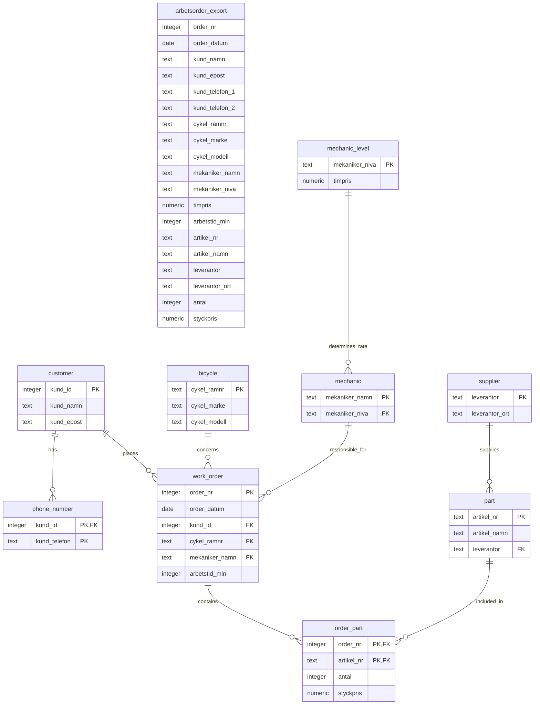

# Cykelverkstaden Trampen — Database Normalization

## Project overview

This project uses sample work-order data from the fictional bicycle workshop Cykelverkstaden Trampen to explore relational database design and normalization.

The starting point is a spreadsheet-style export, `arbetsorder_export`, containing work-order, customer, bicycle, mechanic, supplier, and spare-part information.

The project documents the transformation of the source data through **First Normal Form (1NF), Second Normal Form (2NF), and Third Normal Form (3NF)**. Separate SQL scripts implement the transformations, while test scripts check data integrity, relationships, and preservation of source data.

## Current ER schema — 3NF

The diagram shows the original source relation and the final 3NF relations. The final design separates customer, phone-number, bicycle, mechanic, mechanic-level, supplier, spare-part, work-order, and order-part data.

The final schema uses `work_order` to store one row per work order and `order_part` to store spare-part lines associated with each order. A work order can exist without any rows in `order_part`, as demonstrated by order `1003`.

The `customer` relation uses a generated `kund_id` as its primary key. The design does not assume that email alone uniquely identifies a customer. Phone numbers are stored in `phone_number`, with the composite primary key `(kund_id, kund_telefon)`.

The `bicycle`, `mechanic_level`, and `supplier` relations store attributes determined by their respective identifiers. The `part` relation references `supplier`, so the supplier's town is stored in `supplier` rather than duplicated in `part`.

The `order_part` relation uses the composite primary key `(order_nr, artikel_nr)`, under the assumption that a part number appears at most once per work order. Its `styckpris` records the unit price for that part on that particular order.

The diagram assumes that mechanic names and supplier names are unique because they are used as primary keys in the current design. This is a design assumption rather than a business rule established by the sample data.

## Project timeline

### 1. Create the raw dataset — `01_raw_table.sql`

The first script creates and populates `arbetsorder_export` with nine sample rows representing five work orders.

The table is retained as the original, unnormalized source for analysis and comparison. It contains customer phone numbers in two separate columns (`kund_telefon_1` and `kund_telefon_2`), alongside work-order, bicycle, mechanic, supplier, and spare-part data.

The script also includes an initial row-count check.

### 2. Decompose the data for 1NF — `02_Cykelverkstaden_1NF.sql`

The 1NF step addresses the repeating phone-number columns identified in the original table.

It creates two relations:

- **`work_order`** — initially contains the source attributes except `kund_telefon_1` and `kund_telefon_2`. Spare-part attributes remain at this stage, so work-order information can still be repeated when an order contains multiple parts.
- **`phone_number`** — stores a customer identifier in the form used at this stage and one phone number per row.

The phone-number relation is populated from both phone columns in the source. `UNION` removes duplicate customer–phone pairs that occur when the same customer appears on multiple work orders.

This step separates the phone-number repeating group. It does not yet separate work-order attributes from spare-part line attributes.

### 3. Test the 1NF transformation — `1NF-Tests.sql`

The 1NF tests are kept in a separate file from the transformation script.

The test script includes:

- Checks of the expected number of source rows and distinct work orders.
- Exploratory checks for comma-containing text values, array-typed columns, and numbered or repeating columns.
- Queries examining duplicate values and proposed key combinations in `arbetsorder_export`.
- A check for duplicate rows across the source table's attributes.
- Two-way `EXCEPT` comparisons between the source data and `work_order`.
- Two-way comparisons between source phone-number pairs and `phone_number`.

The comparison queries should return no rows when there are no missing or extra distinct values in the compared data. Because `EXCEPT` compares distinct rows, these tests do not verify duplicate-row counts.

The key-related queries are exploratory: the sample data alone does not establish that a proposed combination is a valid candidate key under the business rules.

### 4. Analyze functional dependencies and decompose for 2NF — `03_Cykelverkstaden_2NF.sql`

The 2NF step examines functional dependencies in the source data and separates spare-part details from work-order details.

The analysis identifies these dependencies in the intended data model:

- `order_nr` determines the work-order attributes, such as the date, customer, bicycle, mechanic, and recorded work time.
- `artikel_nr` determines the spare-part attributes, such as the part name and supplier.
- `(order_nr, artikel_nr)` determines the quantity and unit price recorded for that part on that order.

The script creates or rebuilds these relations:

- **`work_order`** — one row per work order, keyed by `order_nr`. It retains work-order attributes and removes the spare-part columns.
- **`part`** — one row per spare-part number, keyed by `artikel_nr`. It stores the part's descriptive attributes and supplier information.
- **`order_part`** — one row per work-order/part combination, keyed by `(order_nr, artikel_nr)`. It stores the quantity and order-specific unit price.

Primary-key and foreign-key constraints are added to enforce the intended relationships, and data is inserted into the decomposed relations.

The rebuild of `work_order` produces one row per distinct work order, including work order `1003`, whose source row has no article information recorded. The absence of article information is preserved without creating an `order_part` row for that order.

The supplier-to-town dependency (`leverantor → leverantor_ort`) remains for consideration in the 3NF step.

### 5. Test the 2NF decomposition — `2NF-Tests.sql`

The 2NF tests check the decomposed tables and compare them with the source data. They include:

- Expected row counts for `part` and `order_part`.
- Duplicate checks for part numbers and work-order/part key combinations.
- A foreign-key orphan check for `order_part.artikel_nr`.
- Two-way `EXCEPT` comparisons between source article data and `part`.
- Two-way `EXCEPT` comparisons between source order-part data and `order_part`.
- A uniqueness check for `work_order.order_nr`.
- A reconstruction check that compares source rows with rows assembled from `work_order`, `order_part`, and `part`.
- Two-way comparisons between source phone-number pairs and `phone_number`.

The expected counts are specific to this sample dataset; they are checks against the current data, not general requirements of normalization.

As with other `EXCEPT` tests, set-based comparisons do not by themselves verify duplicate-row counts. Reconstruction tests should be interpreted according to their query logic, and additional checks may be needed to establish that no extra reconstructed rows exist.

These tests check data integrity and preservation. The functional-dependency analysis and key assumptions explain the normalization decisions; the tests alone do not prove that a schema is in 2NF.

### 6. Decompose the schema for 3NF — `04_Cykelverkstaden_3NF.sql`

The 3NF step separates attributes that depend on identifiers other than the primary key of their original relation.

The decomposition addresses the following dependencies:

- `cykel_ramnr` determines the bicycle make and model.
- `mekaniker_namn` determines the mechanic level.
- `mekaniker_niva` determines the hourly rate.
- `leverantor` determines the supplier's town.

The script creates or populates these relations:

- **`customer`** — stores customer details using a generated `kund_id` primary key.
- **`phone_number`** — associates phone numbers with customers using `kund_id` and `kund_telefon`.
- **`bicycle`** — stores bicycle make and model by frame number.
- **`mechanic`** — stores mechanics and their levels.
- **`mechanic_level`** — stores the hourly rate associated with each mechanic level.
- **`supplier`** — stores suppliers and their towns.
- **`part`** — references the supplier rather than duplicating the supplier's town.
- **`work_order`** — references the customer, bicycle, and responsible mechanic through foreign keys.

The customer identifier is populated into `work_order` by matching customer name and email. Phone numbers are migrated to the customer identifier and stored in the `phone_number` relation.

The script adds the relevant primary-key and foreign-key constraints, removes attributes that are now stored in their own relations, and applies `NOT NULL` constraints where required by the intended final schema.

The result reduces redundant storage of customer, bicycle, mechanic-level, and supplier information across work orders and parts.

### 7. Test the 3NF schema — `3NF-Tests.sql`

The 3NF test script should validate the final schema and its data. Relevant checks include:

- Expected row counts for the final relations.
- Primary-key uniqueness and non-null values.
- Foreign-key integrity between work orders and customers, bicycles, and mechanics.
- Foreign-key integrity between mechanics and mechanic levels, and between parts and suppliers.
- The composite key and foreign-key relationships in `order_part`.
- Customer phone-number relationships in `phone_number`.
- Preservation of all five work orders, including order `1003`.
- Comparisons between the source data and the final schema where the original and decomposed attributes can be reconstructed meaningfully.

Expected row counts are specific to the sample dataset. As in the earlier test scripts, set-based comparisons should not be treated as duplicate-count checks, and data-preservation tests do not independently prove that the schema satisfies 3NF.

### 8. Prepare the database for rejection tests — `05_Cykelverkstaden_reject_demonstration.sql`

This script prepares the database schema and constraints required by `reject_tests.sql`.

It includes database setup and schema-reset operations, recreates the source data, and builds the relations needed for the final schema. It also adds the check constraints that the rejection tests are intended to demonstrate:

- `work_order_arbetstid_check` rejects negative work time.
- `customer_email_check` rejects email values that do not contain `@`.

Run this script only in the project database. It resets the `public` schema, which removes existing objects in that schema. The script also contains `CREATE DATABASE verkstaddb;`; this statement can fail if the database already exists and must be run outside a transaction.

### 9. Test rejected inserts — `reject_tests.sql`

This script attempts three invalid inserts to demonstrate constraint enforcement.

1. **Work-time check constraint:** attempts to insert work order `9999` with `arbetstid_min = -30`. The insert should be rejected by `work_order_arbetstid_check`.
2. **Foreign-key constraint:** attempts to insert an `order_part` row for work order `9999`. The insert should be rejected by `order_part_work_order_fk` because that work order does not exist.
3. **Email check constraint:** attempts to insert a customer with `kund_epost = 'invalid-email.com'`. The insert should be rejected by `customer_email_check` because the value does not contain `@`.

Run these tests after `05_Cykelverkstaden_reject_demonstration.sql` has created the required schema and constraints.

The second test assumes that work order `9999` was not successfully inserted. If the first test unexpectedly succeeds, the foreign-key test may not fail for the intended reason. Run each statement separately if your SQL client stops executing the script after the first error.

These tests demonstrate selected constraints; they do not prove that every possible invalid database state is prevented.

### 10. Current scope and status

The project documents the normalization process from the raw source relation through 1NF, 2NF, and 3NF, and includes a separate setup and test sequence for demonstrating constraint violations.

The final design separates repeating phone-number values, work-order and spare-part line data, and attributes associated with customers, bicycles, mechanics, mechanic levels, and suppliers.

The design decisions are based on the functional dependencies and key assumptions identified for the intended data model. No additional business rules, such as requiring customer emails to be unique, are assumed unless specified.

## Repository files

| File | Purpose |
|---|---|
| `01_raw_table.sql` | Creates and populates the original `arbetsorder_export` table. |
| `02_Cykelverkstaden_1NF.sql` | Creates and populates the initial `work_order` and `phone_number` relations. |
| `1NF-Tests.sql` | Contains exploratory 1NF/key checks and data-preservation comparisons. |
| `03_Cykelverkstaden_2NF.sql` | Decomposes work-order and spare-part data into `work_order`, `part`, and `order_part`. |
| `2NF-Tests.sql` | Checks keys, references, expected sample counts, and preservation of source data after the 2NF decomposition. |
| `04_Cykelverkstaden_3NF.sql` | Separates customer, bicycle, mechanic, mechanic-level, and supplier data into the final schema. |
| `3NF-Tests.sql` | Tests the final schema's relationships, keys, expected data, and preservation of source information. |
| `05_Cykelverkstaden_reject_demonstration.sql` | Prepares the schema and constraints required to run the rejection tests. |
| `reject_tests.sql` | Attempts three invalid inserts to demonstrate check-constraint and foreign-key violations. |
| `06_Cykelverkstaden_3NF_Simpler_approach.sql` | Alternative end-to-end normalization workflow that builds the final 3NF schema. |

## How to run

### Normalization workflow

1. Open the SQL files in PostgreSQL using a client such as DBeaver.
2. Create the project database if it does not already exist, then connect to it.
3. Run `01_raw_table.sql`.
4. Run `02_Cykelverkstaden_1NF.sql`.
5. Run `1NF-Tests.sql`.
6. Run `03_Cykelverkstaden_2NF.sql`.
7. Run `2NF-Tests.sql`.
8. Run `04_Cykelverkstaden_3NF.sql`.
9. Run `3NF-Tests.sql`.

### Rejection-test workflow

1. Ensure you are connected to the intended project database.
2. Run `05_Cykelverkstaden_reject_demonstration.sql` to prepare the schema and constraints.
3. Run `reject_tests.sql`, preferably one statement at a time if your SQL client stops on errors.

### Alternative workflow

`06_Cykelverkstaden_3NF_Simpler_approach.sql` is an alternative end-to-end workflow. Use it instead of the corresponding sequence of normalization scripts when you want to run that approach. Do not run it merely as the next step after the rejection tests.

**Caution:** The setup scripts can reset the `public` schema. Run them only in the project database, since this removes objects in that schema. Both `05_Cykelverkstaden_reject_demonstration.sql` and `06_Cykelverkstaden_3NF_Simpler_approach.sql` should be treated as setup workflows, not harmless test-only scripts.

##Deletion and referential integrity

The original business rules do not specify how deletion of customers, bicycles, mechanics, suppliers, parts, or work orders should be handled. The database therefore uses restrictive foreign-key behaviour by default to prevent deletion of records that are still referenced. Cascading deletion should be introduced only for dependent records whose lifecycle is intentionally tied to their parent, such as customer phone-number records. Historical work orders and their associated parts should be protected from accidental deletion unless a separate business rule explicitly permits their removal.

## Tools

- PostgreSQL
- DBeaver
- SQL
- Mermaid (ER diagrams)
