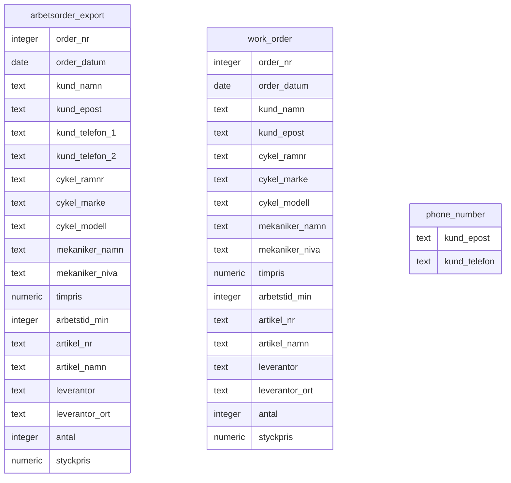

# Cykelverkstaden Trampen — Database Normalization

## Project overview

This project uses sample work-order data from the fictional bicycle workshop Cykelverkstaden Trampen to explore relational database design and normalization.

The starting point is a spreadsheet-style export, `arbetsorder_export`, containing work-order, customer, bicycle, mechanic, and spare-part information.

## Current ER schema — 1NF

The diagram shows the original relation and the two relations created during the 1NF decomposition. It represents the current stage of the project; the schema will be updated as the 2NF and 3NF stages are completed.

## Project timeline

### 1. Create the raw dataset — `01_raw_table.sql`

The first script creates and populates `arbetsorder_export` with nine sample rows representing five work orders.

The table is retained as the original, unnormalized source for analysis and comparison. It contains customer phone numbers in two separate columns (`kund_telefon_1` and `kund_telefon_2`), alongside work-order and spare-part data.

The script also includes an initial row-count check.

### 2. Decompose the data for 1NF — `02_Cykelverkstaden_1NF.sql`

The next script addresses the repeating phone-number columns identified in the original table.

It creates two relations:

- **`work_order`** — contains the original attributes except `kund_telefon_1` and `kund_telefon_2`. The spare-part attributes remain in this relation at this stage.
- **`phone_number`** — stores a customer email and one phone number per row.

The phone-number relation is populated from both phone columns in the source. `UNION` removes duplicate email–phone pairs that occur because a customer may appear on multiple work orders.

This is the current 1NF decomposition; the work-order and spare-part information has not yet been separated further.

### 3. Test the source table and decomposition — `1NF-Tests.sql`

The tests were moved out of `02_Cykelverkstaden_1NF.sql` into a separate file.

The test script includes:

- A check of the expected number of source rows and distinct work orders.
- Exploratory checks for comma-containing text values, array-typed columns, and numbered/repeating columns.
- Queries examining duplicate values and proposed key combinations in `arbetsorder_export`.
- A check for duplicate rows across the source table’s attributes.
- Two-way `EXCEPT` comparisons between the source data and `work_order`.
- Two-way comparisons between the source phone-number pairs and `phone_number`.

The comparison queries should return no rows when there are no missing or extra **distinct** values in the compared data. Since `EXCEPT` compares distinct rows, these tests do not verify duplicate-row counts.

The key-related queries are exploratory: results from the sample data alone do not establish that a proposed combination is a valid candidate key under the business rules.

## Current scope and status

The current stage focuses on identifying and decomposing the repeating customer phone-number columns as part of the 1NF exercise.

`work_order` still combines work-order details with spare-part line data. Further decomposition, functional-dependency analysis, and key decisions remain separate steps in the normalization process.

## Repository files

| File | Purpose |
|---|---|
| `01_raw_table.sql` | Creates and populates the original `arbetsorder_export` table. |
| `02_Cykelverkstaden_1NF.sql` | Creates the `work_order` and `phone_number` relations and populates them from the source table. |
| `1NF-Tests.sql` | Contains exploratory 1NF/key checks and data-preservation comparisons. |

## How to run

1. Open the SQL files in PostgreSQL using a client such as DBeaver.
2. Create the project database, if it does not already exist.
3. Connect to that database.
4. Run `01_raw_table.sql`.
5. Run `02_Cykelverkstaden_1NF.sql`.
6. Run `1NF-Tests.sql` to perform the checks.

**Caution:** The setup scripts reset the `public` schema. Run them only in the project database, since this removes objects in that schema.

## Tools

- PostgreSQL
- DBeaver
- SQL
